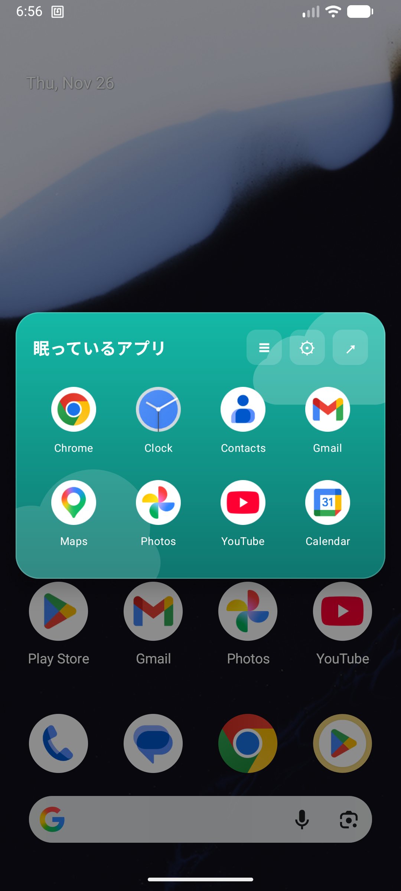
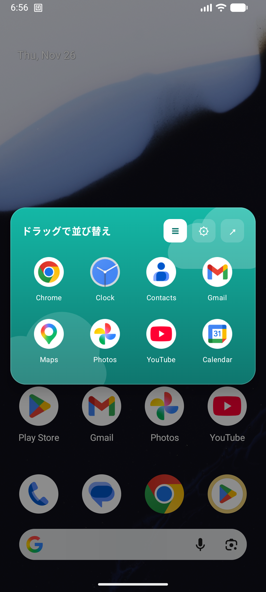

<p align="center">
  
</p>

<h1 align="center">Quicknap</h1>

<p align="center">
  たまにしか使わないアプリに、ちょっと昼寝してもらう Android アプリ
</p>

> **Status: Beta / WIP** — 個人開発中のベータ版です。仕様や UI は予告なく変わることがあります。

眠っている間は通知もアイコンも出ません。使いたくなったら1タップで起きて、ログインもそのまま残っています。

## スクリーンショット

| ホーム画面 1×1 フォルダポップアップ | ドラッグで並び替え |
| :---: | :---: |
|  |  |

## 既存の類似アプリとの違い

- **[Hail](https://github.com/aistra0528/Hail)**：凍結・1タップ起動・画面ロック後の自動凍結ができる汎用ツール。Quicknap は **「最後に使ってから N 日で自動休止」「設定画面を持たない単純さ」「1×1 フォルダウィジェット」** に絞っています
- **[Canta](https://github.com/samolego/Canta)**：不要なアプリをアンインストールするデブロートツール。Quicknap は削除せず無効化するだけなので、ログイン状態や権限が残ります

## できること

- **眠らせる**：選んだアプリを無効化（`pm disable-user --user 0`）し、通知とドロワーのアイコンを消します。アンインストールではないので、ログイン状態や権限は残ります
- **起こして開く**：一覧の行を1タップすると、アプリを有効化してそのまま起動します
- **自動で眠らせる**：最後に使ってから決まった日数（初期値3日）が経つと、自動で眠らせます
- **ホーム画面ウィジェット**：カテゴリごとのフォルダから、眠っているアプリを起こして開けます

## 必要なもの

- Android 12 以上
- [Shizuku](https://shizuku.rikka.app/)（root は不要）
  - 非 root の Shizuku は端末を再起動すると止まります。再起動したあとは Shizuku を開いて再開してください
  - Shizuku が止まっている間も、Android の「アプリ情報」から手動で起こせます

## インストール

1. [Releases](../../releases) から最新のプレリリース版 APK（`quicknap-<バージョン>.apk`）をダウンロードします（または下記の手順でビルドします）
2. 端末で開いてインストールします（「提供元不明のアプリ」の許可が必要です）
3. 初回起動時の案内に沿って、次の3つを許可します

## 使う権限

| 権限 | 使い道 |
| --- | --- |
| Shizuku | アプリの無効化と有効化（`pm` コマンド） |
| 使用状況へのアクセス（`PACKAGE_USAGE_STATS`） | 最後に使った日を調べて、自動で眠らせる時期を決める |
| 全アプリの一覧（`QUERY_ALL_PACKAGES`） | 眠らせるアプリを選ぶ一覧を表示する |
| 通知（`POST_NOTIFICATIONS`） | 自動で眠らせられなかったときに知らせる |

データはすべて端末の中に保存されます。外部への通信はしません。

## 注意

- 動作を確認した端末は Xiaomi（HyperOS 3.0）と Shizuku v13.6.0 の組み合わせだけです
- システムアプリや、銀行・パスワード管理などのアプリを眠らせると困る場合があります。眠らせると困りそうなアプリには、一覧で注意を表示します

## ビルド

```sh
./gradlew :app:assembleDebug
```

リリース署名をする場合は、`~/.gradle/gradle.properties` に `QUICKNAP_STORE_FILE`・`QUICKNAP_STORE_PASSWORD`・`QUICKNAP_KEY_ALIAS`・`QUICKNAP_KEY_PASSWORD` を設定してから `assembleRelease` を実行します。

## ライセンス

[MIT](LICENSE)

### 使用ライブラリ

- [Shizuku-API](https://github.com/RikkaApps/Shizuku-API)（MIT License）
- [AndroidHiddenApiBypass](https://github.com/LSPosed/AndroidHiddenApiBypass)（Apache License 2.0）
- AndroidX / Jetpack Compose（Apache License 2.0）
